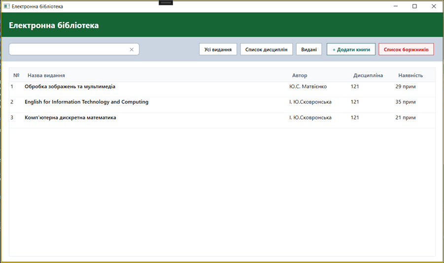
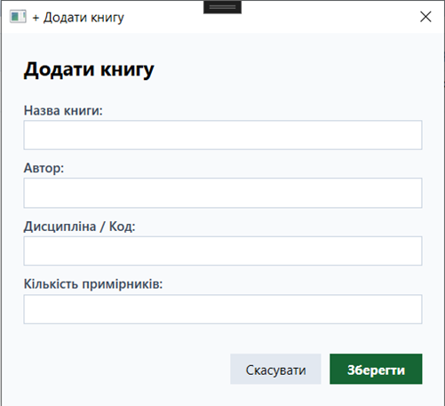
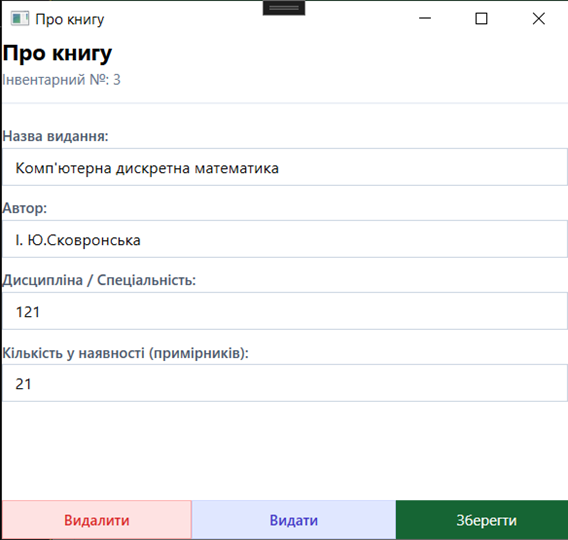
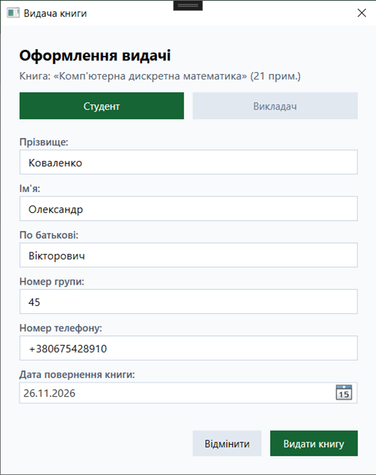
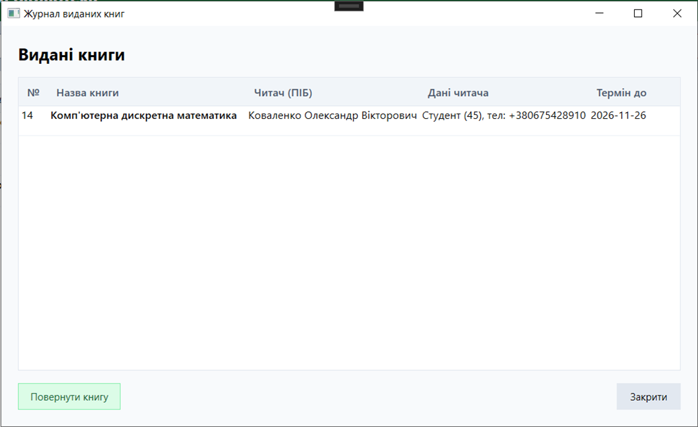
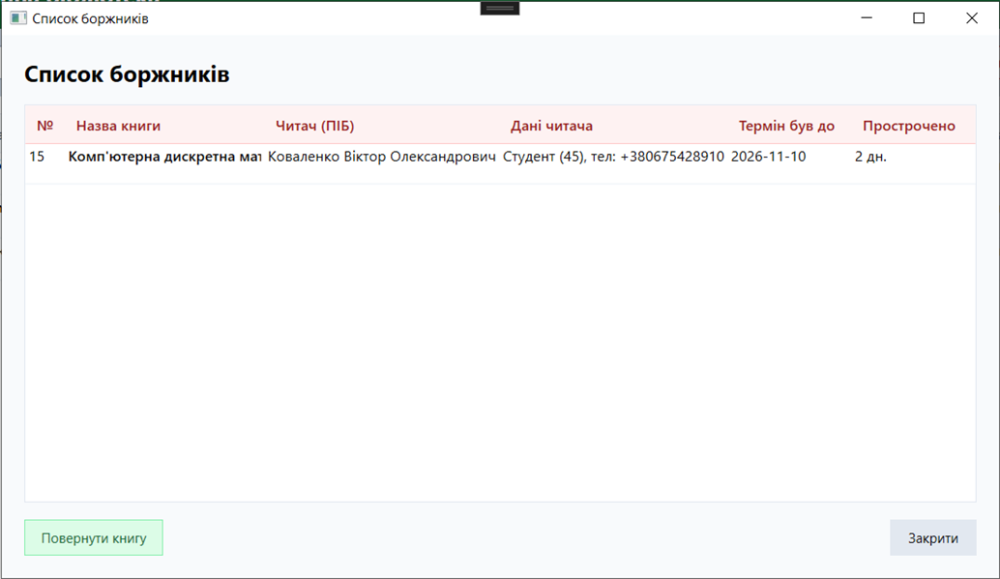

# 📚Електронна бібліотека

Настільний застосунок для обліку та управління бібліотечним фондом навчального закладу, розроблений у межах курсового проєкту з дисципліни «Проєктування автоматизованих інформаційних систем».

## Основні можливості

- **Каталог літератури:** перегляд наявних книг, пошук у реальному часі за назвою, автором або шифром дисципліни.
- **Управління фондом:** додавання нових видань, редагування інформації про книги, зміна кількості примірників та списання літератури.
- **Оформлення видачі:** реєстрація видачі книги студенту або викладачу із зазначенням ПІБ, групи/кафедри, номера телефону та планової дати повернення.
- **Журнал виданих книг:** контроль активних видач та повернення книг до фонду з автоматичним оновленням кількості доступних примірників.
- **Облік боржників:** автоматичне відображення прострочених видач із підрахунком кількості днів затримки.

## Стек технологій

- **Мова програмування:** C# (.NET Framework 4.8)
- **Графічний інтерфейс:** WPF (XAML)
- **База даних:** SQLite (`System.Data.SQLite`)
- **Середовище розробки:** Microsoft Visual Studio

## Структура проєкту

- `Database.cs` — ініціалізація локального файлу бази даних `library.db`, створення таблиць (`Books`, `Debtors`) та початкове наповнення каталогу.
- `MainWindow.xaml` / `.cs` — головне вікно програми з каталогом книг, динамічним пошуком та навігацією.
- `AddBookWindow.xaml` / `.cs` — форма додавання нової книги до каталогу.
- `BookDetailsWindow.xaml` / `.cs` — перегляд картки видання, редагування, видалення та перехід до оформлення видачі.
- `BookLoanWindow.xaml` / `.cs` — форма реєстрації видачі книги читачу.
- `IssuedBooksWindow.xaml` / `.cs` — журнал активних видач та оформлення повернення літератури.
- `DebtorsWindow.xaml` / `.cs` — вікно контролю заборгованостей із розрахунком днів прострочення.

----

## 🖼 Скріншоти інтерфейсу

### 1. Головне вікно
* Список усіх книг у базі з пошуком за назвою, автором чи дисципліною та швидким фільтром.

### 2. Додавання книги
* Форма для внесення нових книг у каталог (назва, автор, дисципліна та кількість примірників).

### 3. Про книгу
* Відкривається подвійним кліком по рядку — тут можна змінити кількість примірників або списати книгу.

### 4. Видача книги
* Вибір студента або викладача, введення ПІБ, групи/посади та вибір дати повернення. При видачі відразу списується 1 примірник.

### 5. Видані книги
* Список книг, які зараз на руках, та кнопка повернення до бібліотеки в один клік.

### 6. Боржники
* Показує тих, хто вчасно не здав книгу, і сам рахує, скільки днів прострочено.

---

## Встановлення та запуск

### Через інсталятор
1. Завантажте **[library_setup.exe](library_setup.exe)** із репозиторію (натисніть на файл і виберіть **Download raw file**).
2. Запустіть файл і встановіть програму.
3. Відкрийте ярлик **«Електрона бібліотека»** на робочому столі або запустіть `Електрона бібліотека.exe` з папки встановлення. База даних створиться сама при першому запуску.
